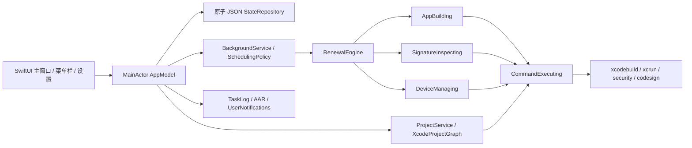

# SignFlow Architecture

Last reviewed: 2026-10-28.

## 模块与数据流

- `SignFlowApp.swift`：单个主窗口、设置 Scene、菜单栏。所有入口共享同一个 AppModel，不产生第二个调度器。
- `Core/Models.swift`：项目、Target、Profile、签名、设备、部署证据、任务阶段、错误和本地设置。部署证据独立于签名快照。
- `Core/ProjectService.swift`、`ProjectGraph.swift`：安全路径发现、Workspace XML / PBX Embed 关系、真实 Scheme 与 Build Settings。只读原工程。每个容器的检查缓存用路径哈希隔离。
- `Core/CommandRunner.swift`：参数数组通过 POSIX spawn 创建专属进程组，DispatchSource 非阻塞读取 stdout / stderr 并保留 UTF-8 分段；退出通知和非阻塞 waitpid 回收子进程。取消与超时限制进程组收尾、输出排空和错误日志处理时间，没有 shell 拼接或阻塞等待。
- `Core/SigningService.swift`：security cms 解码、PropertyList 解析、Security API 证书 / Entitlements、codesign 深度严格验证、嵌套签名关系与保守的 Profile 更新比较。
- `Core/BuildService.swift`：构建计划、输出目录安全检查、设备或 generic destination、自动签名参数与产物搜索。每任务 / Attempt 独立输出，不执行 clean、不覆盖用户 Build Settings 文件。
- `Core/ProfileRefreshService.swift`：共享的构建互斥，按旧签名基线精确选择专属开发 Profile，先备份与中央登记，再临时移出缓存；构建结束恢复、取消恢复、启动恢复、路径与内容校验。备份归类为保留的 USER_DATA。
- `Core/DeviceService.swift`：CoreDevice JSON schema 校验、过滤模拟器、显式未知状态、连接后刷新安装能力、查询应用、覆盖安装及启动。用当前设备详情确认 Watch 直接安装支持，校验连接后的设备标识与选择一致。iPhone 与 Watch 不合并结果。
- `Core/RenewalEngine.swift`：协议驱动、可 Mock 的任务状态机。事件与完整快照回传主模型；签名更新、安装确认、部分成功明确分开。
- `ViewModels/AppModel.swift`：依赖注入、导入流程、串行同工程任务、并发上限、重试预算、持久化、恢复、后台与 UI 协调。
- `Services/BackgroundService.swift`：单一周期循环、wake 观察、SMAppService 登录项。无 daemon、无 root、无单独 LaunchAgent。
- `Services/TaskLog.swift`：分行脱敏与私钥段隐藏，文件写入错误可见。`NotificationService` 提供权限、去重与通知点击路由。
- `Core/ArtifactRegistry.swift`：复用中央 AAR，记录可再生成缓存和构建命令；不会调用清理或实际再生成。

## 持久化与互斥

StateRepository 保存版本化 `PersistedState`，ISO8601 日期、排序 JSON、原子替换与 0600 文件权限。缺失 schema 的空旧格式迁移到 v1；未来版本和损坏数据阻止自动任务并保留源文件。当前不承诺任意历史第三方格式迁移。

InstanceLease 持有数据目录 `scheduler.lock` 的 flock，重复进程不能写同一份状态。ProjectMutex 按规范化容器路径互斥；同容器的多个 Scheme 也串行。不同容器最多 1–4 个任务，其中签名构建经过共享 ProfileRefreshService 串行执行，其他检查和设备任务可并行。默认路径保证主窗口与菜单栏同进程；验收专用 `--storage-root` 只用于隔离测试。

任务每次阶段变更持久化。中断构建使用新 Attempt 避免复用已有 xcresult；中断部署重新检查此任务已有产物。只有此任务已经保存的成功安装证据且设备版本仍匹配时跳过重复安装。无法证明结果时保留未知状态，必要时重新覆盖或等待确认。

自动任务预算通过 Bundle ID、Team、Profile UUID、到期时间形成稳定基线，检查时间或产物路径改变不会重置失败预算。用户手动重试可以重新申请签名资源；Profile 未更新的旧产物不会被当成新请求重复验证。

## UI 状态规则

SwiftUI 绑定产生同值写入时不发布新设置。菜单栏插入状态由异步 MainActor 任务应用，避免在 Scene 更新内发布。主窗口与 Settings Scene 同享配置。所有未确定的设备 / 安装 / 签名状态均有文字标签，不以颜色独立表达。

## 扩展边界

`ApplicationArtifactSource` 提供 `.app` 来源与独立的 IPA 来源接口。IPA adapter 当前明确返回不支持；没有实现重签或解包后安装。未来扩展应保持现有 Xcode 项目状态机、Profile 验证和数据风险门槛。

XCTest 通过 Swift Package 编译相同 Core、Services、ViewModels 文件，覆盖应用层调度、退出和结果提交。Xcode App 使用同步目录直接编译这些文件，无需复制 Core 源码，无第三方包。

2026-10-28 稳定性约束：最终任务结果与项目快照在日志收尾和重试策略之后一起原子保存；可选提交标记用于旧状态恢复。构建目录编号与失败重试预算分开。关闭项目自动续签会暂停其自动任务，用户显式重试只授权一次执行。原生退出等待启动、后台和执行任务收尾。状态采用首次用户认证后的保护等级，保持锁屏期间可读，文件为 0600、新建数据目录为 0700。
