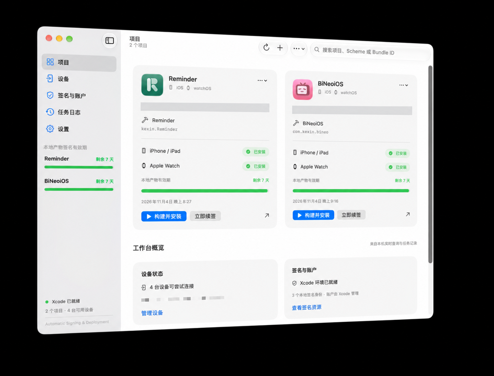

# SignFlow

**SignFlow** 是一款原生 macOS 应用，用于管理 Xcode 项目的签名、构建、安装与续签。它把项目、设备、签名资源和任务记录集中在一个界面，适合需要在 iPhone、iPad 和 Apple Watch 上运行自己开发的应用的开发者。



*截图中的路径已作隐私处理。*

## 功能

- **项目管理**：导入 Xcode 工程或工作区，选择 Scheme，查看项目配置和本地产物的签名状态。
- **构建与安装**：调用本机 Xcode 工具链构建应用，并向可用的 iPhone、iPad 或 Apple Watch 安装；跟踪每台设备的结果。
- **签名与续签**：检查本地产物、嵌套应用和扩展的签名、证书及 Provisioning Profile；按配置检查到期状态并执行续签流程。
- **设备与任务**：查看设备连接状态、安装信息、任务进度、日志、错误和重试结果。
- **后台调度**：主窗口关闭后可通过菜单栏继续使用；支持通知和登录启动设置。

设备上的 Profile 到期时间是依据 SignFlow 已确认的安装记录和对应本地产物计算的**估计值**，并非直接读取设备内应用的签名。外部重新安装或证书撤销可能使实际状态不同。

## 系统要求

- macOS 14 或更高版本；当前开发与验证环境为 macOS 27 和 Xcode 27 Beta，较早系统仍需实际验证。
- Xcode 及其命令行工具；使用自己的 Apple 开发者账户、签名团队与可用的设备。
- Swift 5 语言模式；应用没有第三方库依赖。Swift Package 使用 Swift tools 6.0。

首次运行前，请在 Xcode 中登录 Apple 账户并完成团队、设备信任和开发者模式等配置。在 Xcode 的 **Signing & Capabilities** 中选择自己的团队，必要时修改 Bundle Identifier。也可以在 `Config/Signing.local.xcconfig` 中设置 `DEVELOPMENT_TEAM`；该文件仅保存在本机。

## 构建与运行

在 Xcode 中打开 `SignFlow.xcodeproj`，选择 **SignFlow** Scheme，配置自己的签名团队后运行。

也可以在项目根目录构建一个不签名的调试版本：

```sh
xcodebuild -project SignFlow.xcodeproj -scheme SignFlow \
  -configuration Debug -derivedDataPath build/DerivedData \
  CODE_SIGNING_ALLOWED=NO build
open build/DerivedData/Build/Products/Debug/SignFlow.app
```

运行核心逻辑测试：

```sh
swift test --scratch-path build/SwiftPM
```

当前 Beta 工具链下也可使用 `swift test --build-system native --disable-sandbox --scratch-path build/SwiftPM`。仓库内部分验证脚本以及应用的产物登记和 Profile 备份流程依赖开发者本机的 AAR 登记工具及其固定路径（`~/Documents/Codex/monitor/bin/aar`）；在其他机器上使用相关流程前需要配置对应工具。普通构建命令不要求使用这些脚本。

## 使用

1. 启动 SignFlow，在「项目」中添加 `.xcodeproj`、`.xcworkspace` 或包含工程的目录，选择要管理的 Scheme。
2. 在「设备」中检查目标设备连接状态，并确认 Xcode 和 Apple 账户已准备就绪。
3. 从项目卡片或详情页启动构建安装、检查签名或续签；在「任务日志」中查看进度和结果。
4. 如需自动检查、通知或登录启动，在「设置」中配置。应用进程退出、Mac 睡眠或关机期间不会执行任务。

只导入可信任的 Xcode 项目：构建时项目中的脚本会按 Xcode 的正常行为执行。续签会备份并临时移出精确匹配的本地开发 Profile，之后恢复缺失的原文件；具体机制和失败恢复见 [SIGNING_WORKFLOW.md](SIGNING_WORKFLOW.md)。

## 了解更多

- [架构说明](ARCHITECTURE.md)
- [签名与续签流程](SIGNING_WORKFLOW.md)
- [已知限制](KNOWN_LIMITATIONS.md)

目前不支持通用 IPA 的重签与安装。应用尚未完成 Developer ID 签名与公证，跨 Mac 分发需要另行配置。
